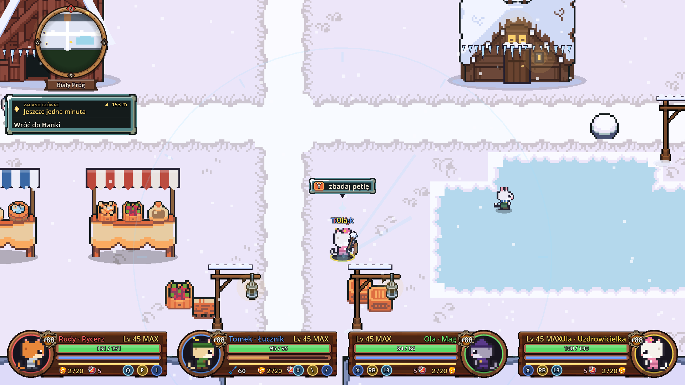
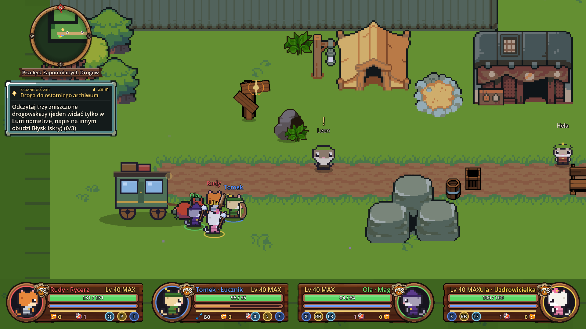
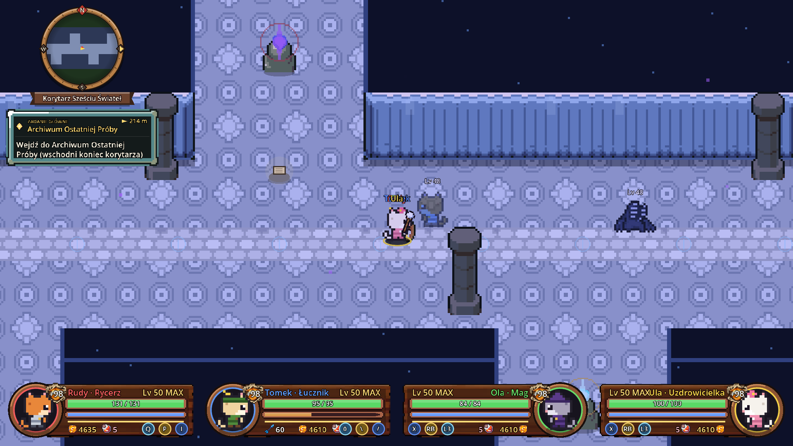

<h1 align="center">Warrior Cats – Iskra Pradawnego Serca</h1>

<b>Wersja testowa 0.9.0</b> · Pełna gra – 10 rozdziałów · Windows 10/11 (64-bit) · polski i angielski

Gra akcji RPG w stylu Cat Quest: pixel art, walka w czasie rzeczywistym, zadania i sekrety,
a do tego **lokalna kooperacja dla 1–4 graczy** na padach lub dwóch zestawach klawiszy na jednej klawiaturze.
Całą grę da się też przejść samemu – każdą klasą.

## ⬇️ Pobierz

Wejdź w **[Releases → najnowsze wydanie](../../releases/latest)** i pobierz jeden z plików:

| Plik | Co to jest |
|---|---|
| `WarriorCats-Setup-0.9.0.exe` | **Instalator** (polecany) – instaluje grę, tworzy skrót na pulpicie i w menu Start. Nie wymaga uprawnień administratora. Można instalować na starszą wersję – zapisy postaci zostają. |
| `WarriorCats-0.9.0-bez-instalacji.zip` | Wersja bez instalacji – rozpakuj i uruchom `WarriorCats.exe`. |

> **Windows może ostrzec** („System Windows ochronił ten komputer”), bo gra nie ma płatnego podpisu cyfrowego.
> Kliknij **Więcej informacji → Uruchom mimo to**.

## 🐾 O grze

Rudy wyrusza ratować swój świat, w którym gasną pradawne kryształy – a po drodze odkrywa, kto i dlaczego
próbował połączyć sześć świateł świata w jedno.

1. **Iskra Pradawnego Serca** – wioska Brzozowy Kieł, Szepczący Las i Ruiny Srebrnej Kapliczki.
2. **Cień nad Srebrnym Brodem** – osada nad rzeką, Mokradła Milczącej Wody i Stara Tama z zagadkami.
3. **Miasto, Które Zgubiło Cień** – Lśniący Gród, Dzielnica Wynalazców, Wieża Bez Cienia. Nowe narzędzie: Luminometr.
4. **Królestwo Pod Lodowym Słońcem** – Biały Próg, kopalnia i lodowiec, gdzie czas stanął w miejscu. Nowa moc: Puls Czasu.
5. **Miejsce, Którego Nie Ma na Mapie** – dolina i osada, o których wszyscy zapomnieli.
6. **Ogród, Który Zapomniał Rosnąć** – Zielony Szept, Sad Wiecznego Lata i Las Niedokończonej Jesieni.
7. **Miasto pod Drugim Niebem** – podziemne miasto pod sztucznym niebem.
8. **Imię Ukryte pod Maską** – Przełęcz Zapomnianych Drogowskazów i Opuszczony Ośrodek Pamięci.
9. **Kiedy Świat Woła o Pomoc** – powroty do wszystkich krain i Węzeł Zerwanej Sieci.
10. **Iskra Pradawnego Serca** – wielki finał pod Ruinami Srebrnej Kapliczki.

**W grze:** cztery klasy (Rycerz, Łucznik, Mag, Uzdrowicielka), rozwój postaci punktami cech, ekwipunek z przedmiotami
zwykłymi, rzadkimi i legendarnymi, bossowie z fazami i słabymi punktami, zadania poboczne z nagrodami, sekrety,
domy, do których można wejść, jaskinie z falami wrogów, Dziennik zadań i wybór tematu rozmowy.

**Nowe w 0.9.0:**
- rozdziały 4–10 i zakończenie gry,
- poziom trudności (Łatwy / Normalny / Trudny),
- autozapis i powrót do ostatniego zapisu po porażce drużyny,
- „Utknąłem” w menu pauzy,
- nowy balans klas pod grę w pojedynkę,
- przy kilku graczach w rozmowie widać portrety całej drużyny.

   
   
   
   
   
   

## 🎮 Sterowanie (domyślne – można zmienić w grze)

| | Pad | Klawiatura 1 | Klawiatura 2 |
|---|---|---|---|
| Ruch / celowanie | gałka | WASD | strzałki |
| Atak | A | J | , |
| Unik (Iskrowy Skok) | B | K | . |
| Umiejętność klasy | X | I | / |
| Strzał / kula ognia | RT | U | ' |
| Akcja / rozmowa | Y | L | ; |
| Mikstura leczenia | LB | O | [ |
| Błysk Iskry | RB | P | \ |
| Luminometr (przytrzymaj: Cienisty Zmysł) | R3 | E | = |
| Puls Czasu | L3 | Q | 0 |
| Ekwipunek | View | Tab | ] |
| Dziennik (zadania, postać) | LT | M | - |
| Pauza / zapis | Start | Esc | Esc |

Dołączanie do drużyny na ekranie „Wybór drużyny”: **A** na padzie, **J** lub **,** na klawiaturze. Start gry: **Start** / **Enter**.

## 🐞 Testujesz? Daj znać!

To wersja testowa. Jeśli coś nie działa, opisz, **gdzie** to było i **co** się stało (zrzut ekranu bardzo pomaga).

---

Grafika, muzyka i dźwięki: [Ninja Adventure – Asset Pack](https://pixel-boy.itch.io/ninja-adventure-asset-pack) (CC0),
[Pixel Crawler](https://anokolisa.itch.io) (Anokolisa), [Tiny RPG Character Asset Pack](https://zerie.itch.io/tiny-rpg-character-asset-pack) (Zerie),
[Raven Fantasy Icons](https://clockworkraven.itch.io) (Clockwork Raven Studios), [Farm RPG](https://emanuelledev.itch.io/farm-rpg) (Emanuelle)
i inne – pełna lista w grze (menu „Twórcy”) i w pliku `Licencje.txt`.
Silnik: [Godot Engine](https://godotengine.org) (MIT).
