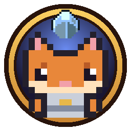
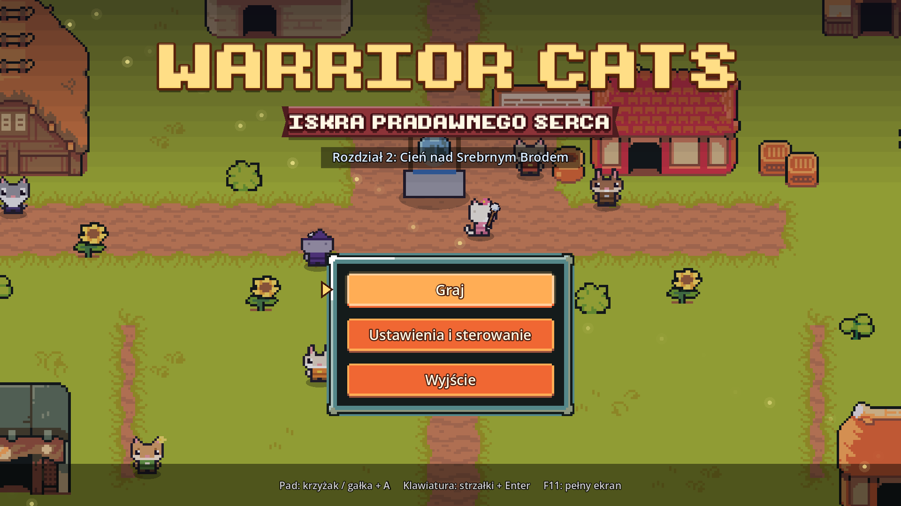
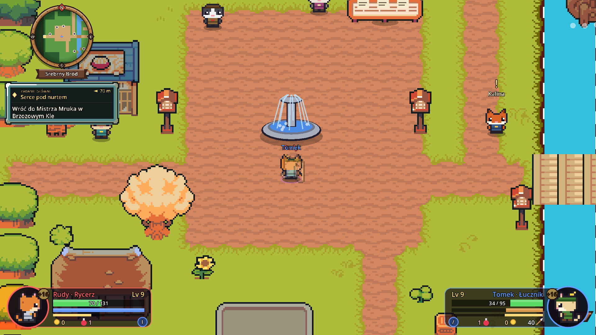
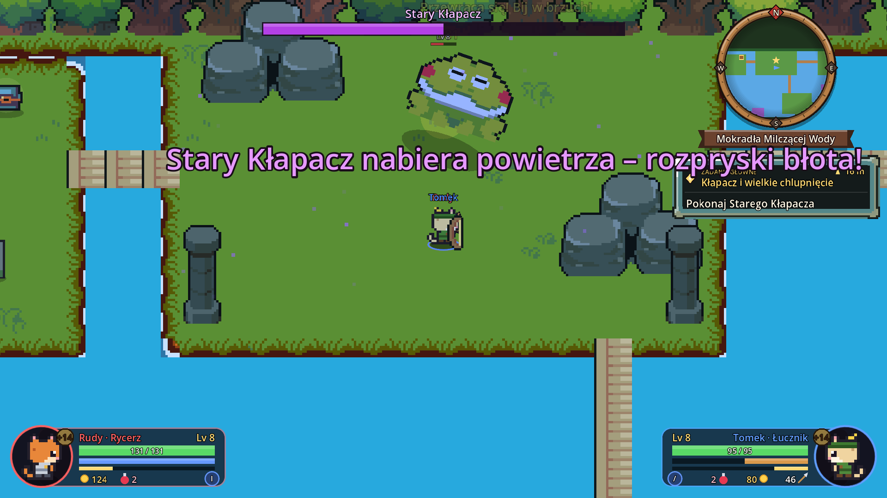
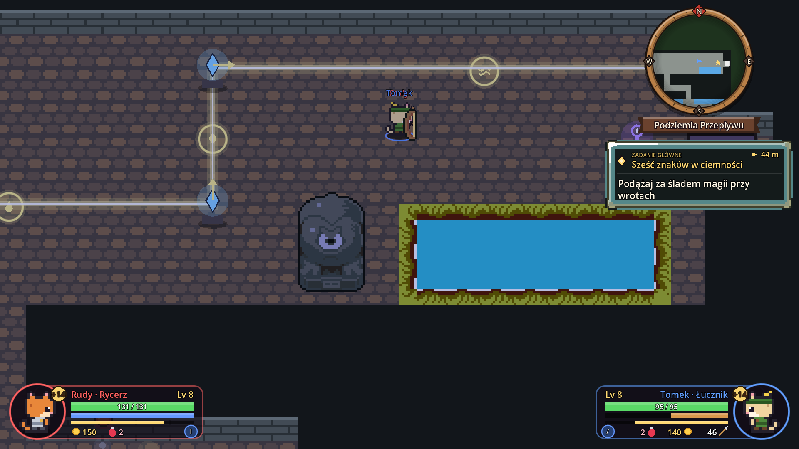
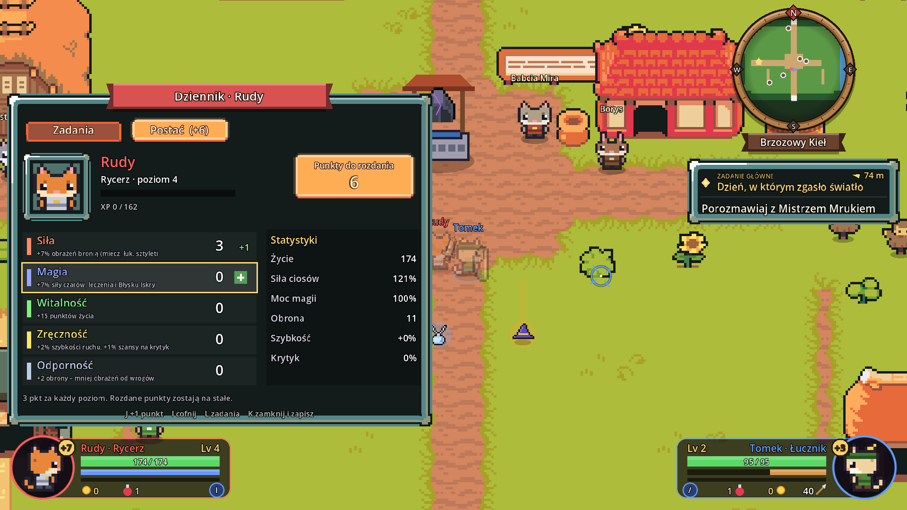
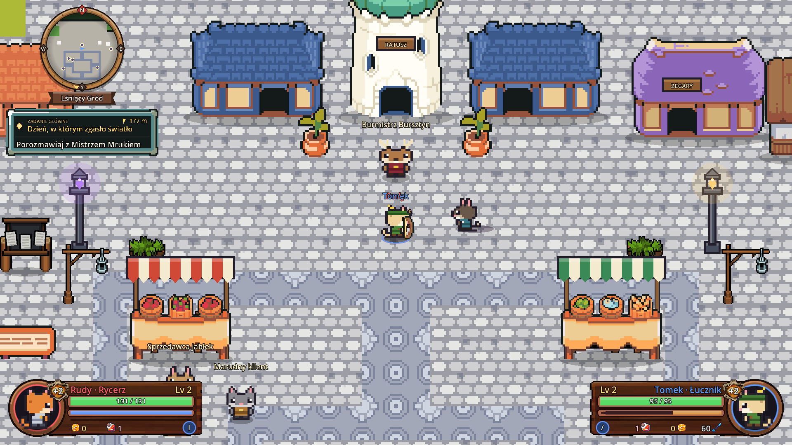
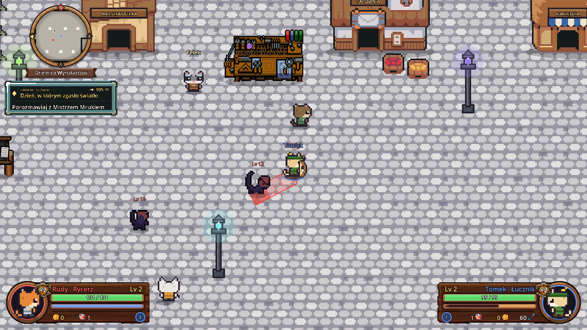
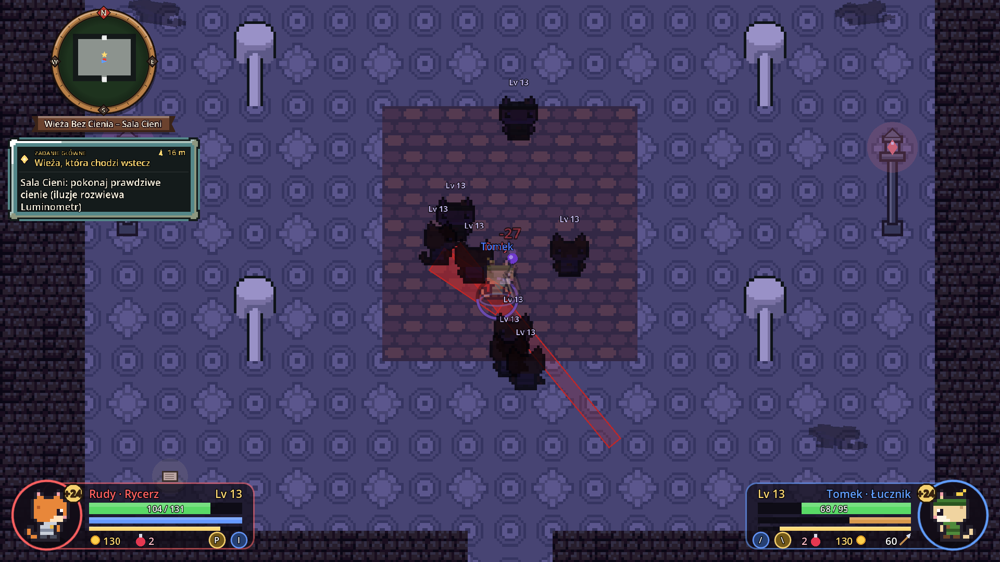
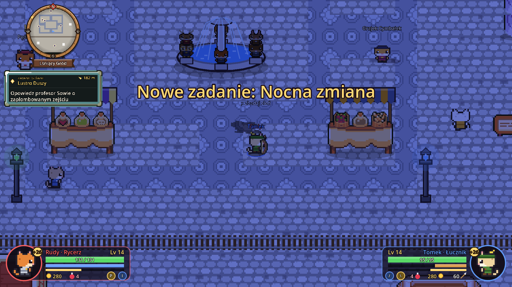

<h1 align="center">Warrior Cats – Iskra Pradawnego Serca</h1>

<b>Wersja testowa 0.3.1</b> · Rozdziały 1, 2 i 3 · Windows 10/11 (64-bit)

Gra akcji RPG w stylu Cat Quest: pixel art, walka w czasie rzeczywistym, zadania i sekrety,
a do tego **lokalna kooperacja dla 1–4 graczy** na padach lub dwóch zestawach klawiszy na jednej klawiaturze.

## ⬇️ Pobierz

Wejdź w **[Releases → najnowsze wydanie](../../releases/latest)** i pobierz jeden z plików:

| Plik | Co to jest |
|---|---|
| `WarriorCats-Setup-0.3.1.exe` | **Instalator** (polecany) – instaluje grę, tworzy skrót na pulpicie i w menu Start. Nie wymaga uprawnień administratora. |
| `WarriorCats-0.3.1-bez-instalacji.zip` | Wersja bez instalacji – rozpakuj i uruchom `WarriorCats.exe`. |

> **Windows może ostrzec** („System Windows ochronił ten komputer”), bo gra nie ma płatnego podpisu cyfrowego.
> Kliknij **Więcej informacji → Uruchom mimo to**.

## 🐾 O grze

Rudy wyrusza ratować swój świat, w którym gasną pradawne kryształy:

- **Rozdział 1: Iskra Pradawnego Serca** – wioska Brzozowy Kieł, Szepczący Las i Ruiny Srebrnej Kapliczki.
- **Rozdział 2: Cień nad Srebrnym Brodem** – Droga nad Srebrny Bród, osada nad rzeką, Mokradła Milczącej Wody,
  Stara Tama z podziemnymi zagadkami i Serce Tamy.
- **Rozdział 3: Miasto, Które Zgubiło Cień** – Lśniący Gród, Dzielnica Wynalazców, Archiwum Miejskie,
  Wieża Bez Cienia i Podziemne Archiwum z Lustrem Duszy. Nowe narzędzie: Luminometr.

Cztery klasy (Rycerz, Łucznik, Mag, Uzdrowicielka), rozwój postaci punktami cech, ekwipunek z siedmioma miejscami (z ozdobą)
i przedmiotami zwykłymi, rzadkimi i legendarnymi, bossowie, sekrety, Dziennik zadań i zapis postępu każdej postaci.
Do domów w osadach można wchodzić (i zaglądać do skrzynek), a w jaskiniach czekają 3 fale wrogów i skrzynia z rzadkim łupem.

   
   
   
   
  

## 🎮 Sterowanie (domyślne – można zmienić w grze)

| | Pad | Klawiatura 1 | Klawiatura 2 |
|---|---|---|---|
| Ruch / celowanie | gałka | WASD | strzałki |
| Atak | A | J | , |
| Unik | B | K | . |
| Umiejętność klasy | X | I | / |
| Strzał / kula ognia | RT | U | ' |
| Akcja / rozmowa | Y | L | ; |
| Mikstura leczenia | LB | O | [ |
| Błysk Iskry | RB | P | \ |
| Luminometr (przytrzymaj: Cienisty Zmysł) | R3 | E | = |
| Ekwipunek | View | Tab | ] |
| Dziennik (zadania, postać) | LT | M | - |
| Pauza / zapis | Start | Esc | Esc |

Dołączanie do drużyny na ekranie „Wybór drużyny”: **A** na padzie, **J** lub **,** na klawiaturze. Start gry: **Start** / **Enter**.

## 🐞 Testujesz? Daj znać!

To wersja testowa. Jeśli coś nie działa, opisz, **gdzie** to było i **co** się stało (zrzut ekranu bardzo pomaga).

---

Grafika, muzyka i dźwięki: [Ninja Adventure – Asset Pack](https://pixel-boy.itch.io/ninja-adventure-asset-pack) (CC0).
Silnik: [Godot Engine](https://godotengine.org) (MIT).
